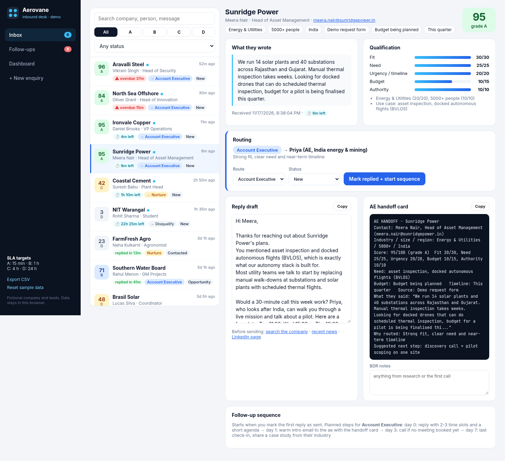
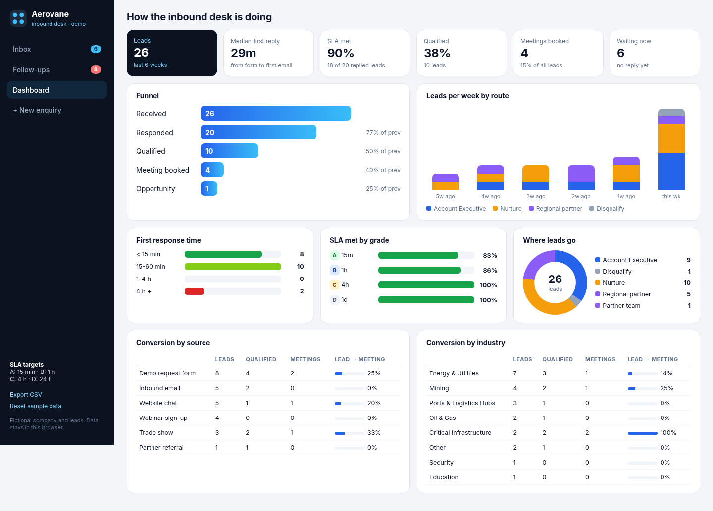
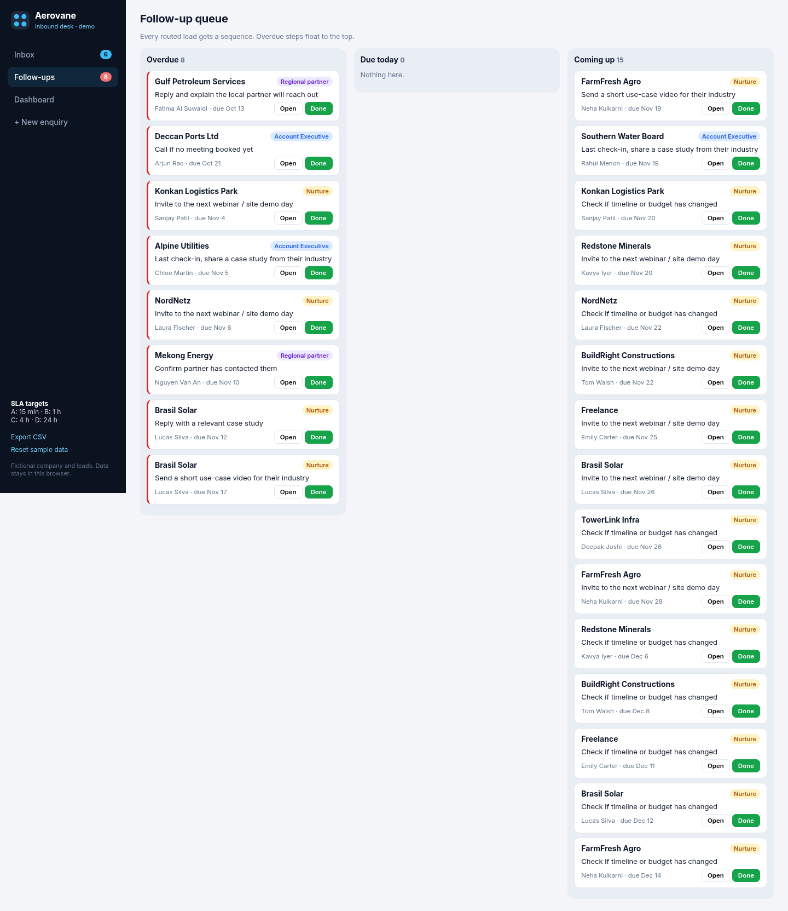
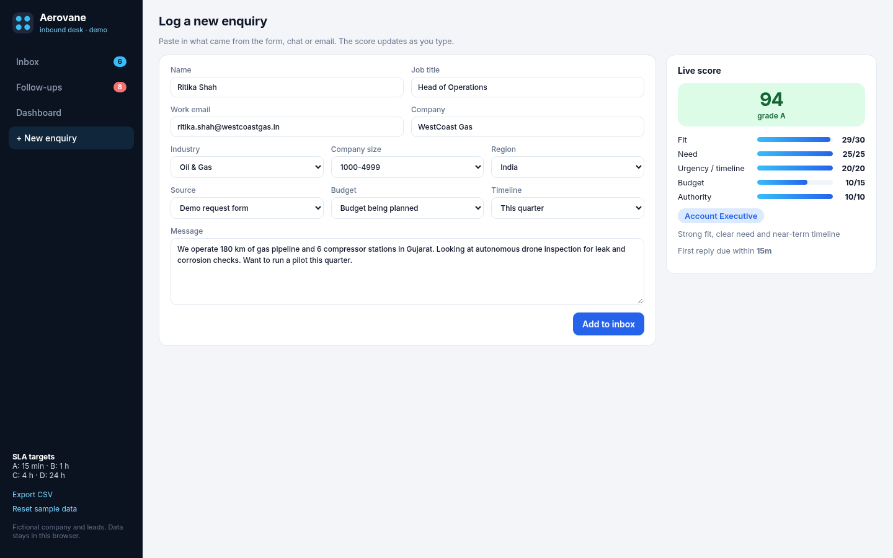

# Inbound Lead Qualifier (drone autonomy demo)

Live demo: **https://inbound-lead-qualifier.vercel.app**

An inbox for inbound enquiries at a company that sells autonomous drone systems (docks, patrol and inspection flights) to energy, mining, security and infrastructure teams. Each enquiry gets scored, routed to the right owner, and put on a follow-up sequence, with a timer so first replies don't slip.

The company ("Aerovane Autonomy"), the people and all the leads are made up.



## Why I built this

I'm really into drones and automation (I run an Ender-3 3D printer and turned it into a pen plotter, which got me reading a lot about motion control and autonomy), and I've done field sales in my family's business. I wanted to understand what the inbound side of selling a technical product looks like: someone fills a demo form, and you have minutes, not days, to figure out who they are, whether they're a fit and who should talk to them next.

Most of the logic here is me trying to write down how I'd think about a lead:

- Is the company the kind we sell to? (industry, size)
- Do they actually have a problem we solve? (what they wrote)
- When do they want to move? Is there budget?
- Is this person someone who can push it internally?

## Scoring

Total is out of 100, split BANT-style:

| Part | Max | What counts |
|---|---|---|
| Fit | 30 | industry (energy, oil & gas, mining, security, critical infra, ports score highest) + company size |
| Need | 25 | use cases found in the message (inspection, perimeter patrol, stockpile survey, pipelines / lines, docked BVLOS flights, incident response) and whether they mention scale like "14 sites" or "300 km" |
| Urgency / timeline | 20 | timeline they picked, plus words like RFP, tender, pilot, urgent; minus words like "just exploring" |
| Budget | 15 | approved / being planned / none / not shared, RFP or tender counts as a strong signal |
| Authority | 10 | job title seniority |

Personal email domains lose a few points. Grades: A ≥ 75, B ≥ 55, C ≥ 35, D below.

## Routing

- **Job seekers / students** → polite reply, disqualified
- **Resellers / distributors** → partner (channel) team
- **Regions we don't sell into directly** (Middle East, Africa, SE Asia, LatAm) → that region's partner if the lead is decent, otherwise nurture
- **Score 70+ with a near-term timeline or budget** → Account Executive for that territory
- **Score 55-69 but budget approved or "this quarter"** → Account Executive
- **Everything else** → nurture sequence

You can override the route on any lead, and it shows that it was changed by hand.

## Other bits

- **SLA timer** on every unanswered lead: A = 15 min, B = 1 h, C = 4 h, D = 24 h. It turns amber near the limit and red once it's breached. The inbox sorts unanswered leads by the closest deadline.
- **Reply draft** that uses their name, what they asked about and an industry-specific line, plus quick links to research the company before sending.
- **AE handoff card**: one block of text with contact, score breakdown, need, budget, timeline, their own words and why it was routed. Copy and paste into Slack or the CRM.
- **Follow-up sequences** per route (e.g. AE: reply with slots → intro to AE → call → last check-in). The follow-up tab shows overdue / today / upcoming.
- **Dashboard**: funnel (received → responded → qualified → meeting → opportunity), leads per week by route, first response time buckets, SLA met by grade, conversion by source and by industry.
- **New enquiry form** with a live score preview while you type.
- CSV export. Data stays in the browser (localStorage).

| Dashboard | Follow-ups |
|---|---|
|  |  |



## Run it locally

Plain HTML / CSS / JS modules, no build.

```bash
git clone https://github.com/Shibukedang27/inbound-lead-qualifier.git
cd inbound-lead-qualifier
python3 -m http.server 5174     # or: npx serve .
# open http://localhost:5174
```

Tests for the scoring and routing rules:

```bash
npm test
```

## Files

```
js/rules.js     scoring, routing, SLA, sequences, reply + handoff text, report maths
js/sample.js    fictional leads
js/store.js     localStorage
js/app.js       UI
tests/          node:test tests for rules.js
```

## What I'd do next

- pull enquiries from a real form or a shared inbox instead of typing them in
- push the handoff card into a CRM (HubSpot / Zoho) through their API
- let the AE mark the meeting outcome so the scoring weights can be checked against what actually converted
